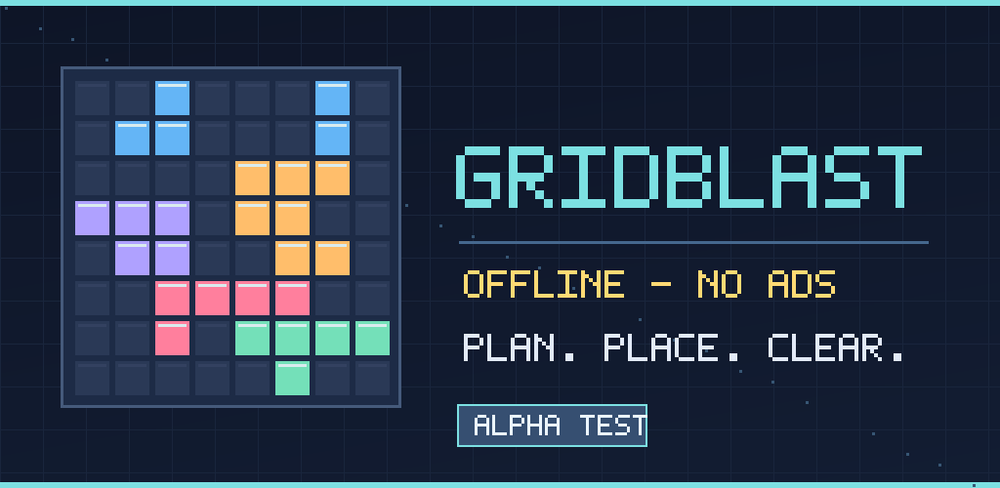
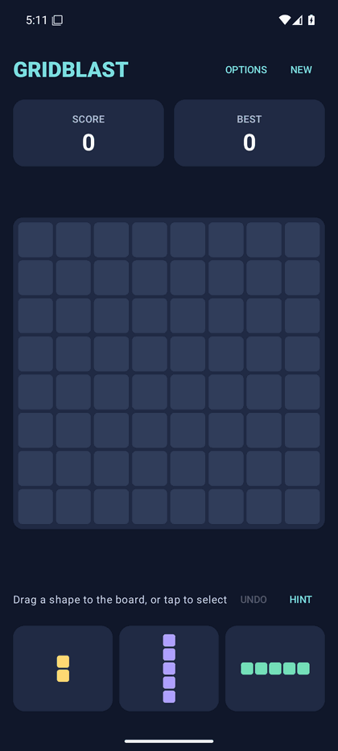
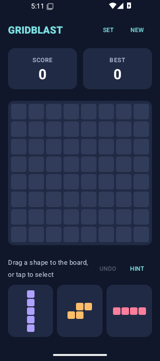
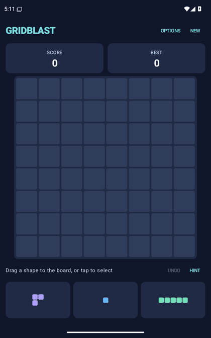

# GridBlast



**[Install the Android alpha](docs/ALPHA_PLAYTEST.md)** · **[Send playtest feedback](https://github.com/ProhibitedTV/GridBlast/issues/new?template=alpha-playtest.yml)** · **[Launch roadmap](docs/LAUNCH_AUDIENCE_PLAN.md)**

**An original, free, ad-free Android block puzzle game.** No ads, no tracking, no accounts, no subscriptions, and no network permission. Native Kotlin and Jetpack Compose.

## Screenshots

<p align="center">
  
  
  
</p>

*Real captures of GridBlast running in [Android emulator CI](https://github.com/ProhibitedTV/GridBlast/actions/runs/42258584585) (Android 15 standard and 320dp phones; Android 16 tablet viewport), not UI mockups. These resized screenshots show the initial board, not a mid-game session. Emulator screenshots are not physical-device or final Google Play store captures.*


## Play

Place shapes on an 8×8 grid. Fill a row or column to clear it and score more points. Use all three pieces to receive three new ones. New trays guarantee at least one legal placement when any shape can fit, so the next tray cannot end a round purely through bad luck. The round ends when no available piece can fit anywhere.

- **Drag a piece** from the tray onto the grid. The lifted piece and board preview share the same placement anchor; red means it won't fit. Completed lines glow before you release a valid move, and the status text previews the clear and points. Invalid drops show a brief explanation without using up the piece.
- Alternatively, **tap a piece**: valid top-left placement cells get a subtle teal outline. Tap one of these anchors to place it, or tap the selected piece again to deselect. Outlines disappear while dragging, using a HINT preview, or after placing a piece.
- Your current round, most recent undo checkpoint, and best score save automatically on the device.
- **Options → HOW TO PLAY** opens an offline, scrollable rules and controls guide; returning to the game does not reset the round.
- **New Game** asks for confirmation when you've scored points.
- Cleared cells briefly flash and the earned points are displayed.
- **Options** independently controls sound, vibration, and clear animations. Original synthesized sound effects are disabled by default. Even when enabled, effects remain silent in the device's Silent/Vibrate modes or when media is muted/at zero volume; GridBlast never changes system audio settings.
- **Hint** is always free and available offline. Press **HINT** to preview a move and its point value; it prefers moves that do not immediately end the round, even when they score fewer points. When all moves lose, it still suggests the best scoring move. Tap the highlighted board cell **or press PLACE** to confirm it. HINT alone never spends points or moves pieces.
- **Undo** reverts the most recent successful placement for free, including after game over. Only one turn is available at a time; it survives app restarts, and your all-time best score is never reduced.

## Accessibility

Every tray piece is selectable by tap, switch access or screen reader. **TalkBack announces each shape's dimensions and occupied columns row by row**, so pieces with the same block count can be distinguished without relying on color or sight. Once a shape is selected, legal board locations are marked as actionable; illegal placements cannot be activated. **HINT → PLACE** offers a shorter, two-action route to a recommended move without navigating the entire board. Undo, New Game and Options are ordinary accessible buttons. Please report real-device TalkBack problems in [issue #5](https://github.com/ProhibitedTV/GridBlast/issues/5); automated semantic tests are not a substitute for human evaluation.

## Build from a clean checkout

Requirements: Android SDK 37.0 (with SDK platform tooling), Android Studio or JDK 17, and an internet connection for initial Gradle/Android dependency downloads. **You do not need Gradle installed**: this repository commits the official Gradle 9.8.2 wrapper and verifies the wrapper JAR against Gradle's official SHA-256 and pins the distribution ZIP checksum.

```bash
git clone https://github.com/ProhibitedTV/GridBlast.git
cd GridBlast
./gradlew :app:testDebugUnitTest :app:assembleDebug
```

On Windows, run `gradlew.bat :app:testDebugUnitTest :app:assembleDebug`. Android Studio can open this directory as an existing project. On systems where Android SDK 37 is exposed as `android-37.0`, CI sets an `android-37` compatibility path; your local SDK may need the same symlink until tooling supports the renamed platform.

**Install an alpha:** Follow the [Android download and playtest guide](docs/ALPHA_PLAYTEST.md). Select a successful **main** Android CI run, download the `GridBlast-debug` artifact, extract `app-debug.apk`, and install it on your phone. GitHub sign-in is needed; this is a debug alpha, not a Play Store release.

## Signed release candidates

The workflow at `.github/workflows/android-release.yml` is triggered by a `v*` tag or a manual dispatch. It **fails closed** until you configure these four GitHub Actions secrets:

| Secret | Meaning |
| --- | --- |
| `GRIDBLAST_RELEASE_KEYSTORE_B64` | Base64-encoded Android release signing keystore |
| `GRIDBLAST_RELEASE_STORE_PASSWORD` | Keystore password |
| `GRIDBLAST_RELEASE_KEY_ALIAS` | Signing key alias |
| `GRIDBLAST_RELEASE_KEY_PASSWORD` | Signing key password |

Keep an encrypted backup of your release keystore and passwords; losing your original signing identity can prevent future update distribution. **Do not commit a keystore or secrets.** After secrets exist and hardware QA is complete, you can create a version tag or run the release workflow manually. Successful runs produce signed APK and AAB artifacts with their APK signature verified. A build artifact is not automatically a public Play Store listing or GitHub Release.

Normal PR CI also checks unsigned release bundle compilation, validates the committed wrapper, and rejects APKs with internet/network/advertising permissions.

### Owner-signed beta APKs and progress-safe upgrades

For testers who want to keep their game when installing newer betas, use the separate **manually dispatched [owner-signed beta workflow](.github/workflows/android-beta.yml)** (after the owner configures it). This is distinct from the Google Play upload/release signing identity. It is **not** enabled simply by creating the workflow file.

Configure five **GitHub Actions repository secrets** before the first beta build: `GRIDBLAST_BETA_KEYSTORE_B64`, `GRIDBLAST_BETA_STORE_PASSWORD`, `GRIDBLAST_BETA_KEY_ALIAS`, `GRIDBLAST_BETA_KEY_PASSWORD`, and `GRIDBLAST_BETA_CERT_SHA256` (the 64-digit SHA-256 signing certificate fingerprint; colon-separated format also works). Back up the original beta keystore in an encrypted, offline location. Generate and inspect this signing identity locally; **never paste keystores, certificates with private keys or passwords into GitHub issues, chat, code or artifacts**.

A maintainer selects **Actions → Android owner-signed beta APK → Run workflow → main**. The workflow refuses other branches and missing secrets, verifies the certificate fingerprint before uploading, checks privacy/permissions and assigns an increasing `versionCode` from its workflow run number (starting above 10000). It uploads **only an APK** for controlled beta sideload testing—not an AAB, Play production release, or unsigned artifact. Do not redistribute a *rerun of an older workflow execution* as if it were a newer upgrade; reruns reuse that original run's version code.

As an automated safety check, `android-upgrade.yml` builds two debug APK versions with a newly generated key held only within the same GitHub Actions runner. It installs A, plays and changes settings, then installs B **over A** and tests board, Undo, best score and preferences on Android 8 and Android 16 emulators. The temporary APKs and keystore are **never uploaded**. This proves a constrained debug-app update path when CI passes; owner-signed release upgrades still require separate real-phone acceptance.

Test a real device with **two consecutive** owner-signed beta artifacts: install A, play and note board/score/Undo, then `adb install -r app-release.apk` for B *without uninstalling or clearing storage*. Confirm the exact game and settings survive. Both artifacts **must** use the same beta signing certificate and B must have the higher version code. A preexisting CI `GridBlast-debug` install, a different beta key, or the eventual Google Play identity may be incompatible; Android does not silently migrate app-private saves across a signing-key change. Tell those testers that uninstalling erases progress. Until this owner-key flow and real-device upgrade are completed, [issue #50](https://github.com/ProhibitedTV/GridBlast/issues/50) remains open.

**Signing smoke tests:** `.github/workflows/android-signing-smoke.yml` creates a **new disposable test key for every CI run**, compiles and verifies signed APK/AAB outputs, then deletes the test key. Those artifacts are **never uploaded** because they are not usable as a Play production signing identity. This validates the release signing code path without exposing or requiring your real upload keystore. Actual Google Play publishing still requires the four owner-configured signing secrets and a separately verified signed release.

## Architecture

- `app/src/main/java/tv/prohibited/gridblast/game`: deterministic Android-independent game rules, placement geometry, one-move history and versioned save-state codecs
- `app/src/main/java/tv/prohibited/gridblast/ui`: Compose board, gesture controls, previews and scoring
- `app/src/test`: JVM gameplay and placement regression tests
- `app/src/androidTest`: instrumentation smoke tests for real UI interactions and persisted state
- `.github/workflows/android.yml`: debug CI and privacy gate
- `.github/workflows/android-release.yml`: guarded signed-release pipeline
- `PRIVACY.md`: privacy policy
- `CHANGELOG.md`: release history

## Privacy and independence

No `INTERNET`, advertising ID, location, analytics or tracking permission. Local saves are excluded from automatic backup and device transfer on supported Android versions, and the privacy policy is readable offline under **Options → Privacy Policy**. Board, score and preferences stay in private Android storage and are never uploaded. See [PRIVACY.md](PRIVACY.md).

GridBlast uses independent game code, visuals and naming. It is not affiliated with Block Blast or its publisher.

See [Google Play release checklist](docs/GOOGLE_PLAY_RELEASE_CHECKLIST.md) and [draft Play listing](docs/PLAY_STORE_LISTING.md) for publication prerequisites. Google Play approval is not guaranteed by a successful build.

## Remaining pre-1.0 work

- Verify drag placement, hints, compact toolbar, TalkBack, audio behavior and performance on physical phones and tablets.
- Production screenshots, store metadata and signing secrets.
- Automated emulator UI tests on Android 10, Android 15, and an Android 15 320dp-wide phone layout; deeper physical-device validation, feature polish and gameplay balance.

## License

MIT. See [LICENSE](LICENSE).
